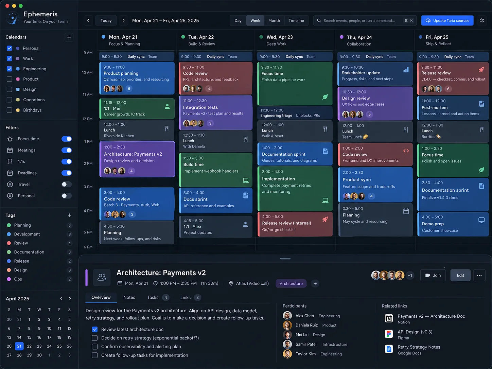
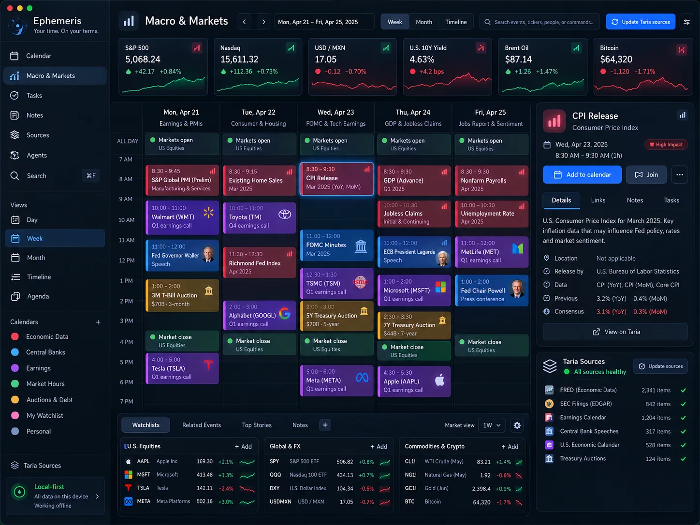
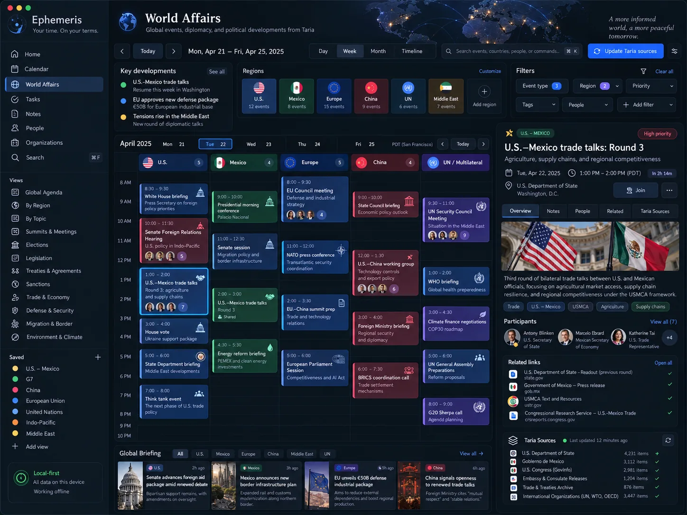
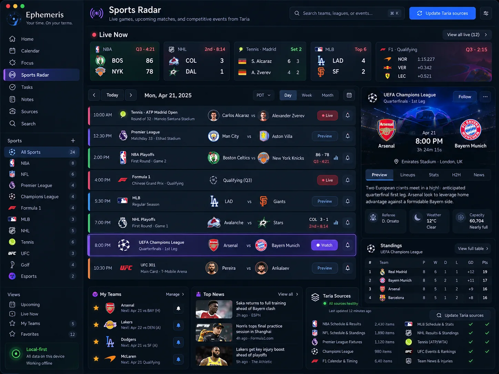
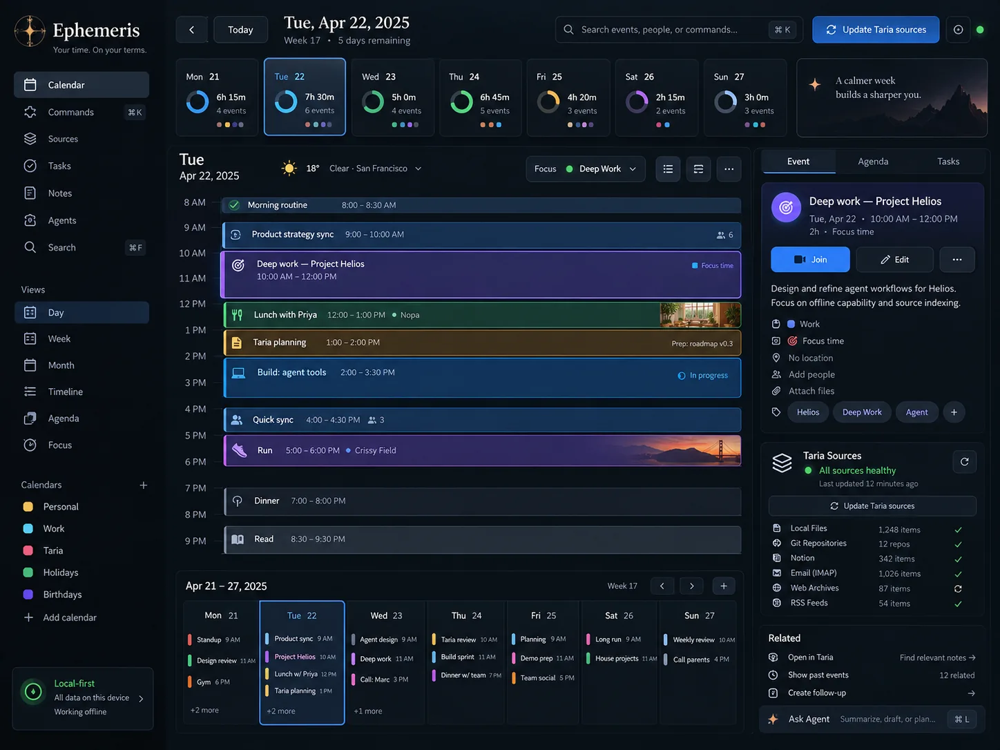
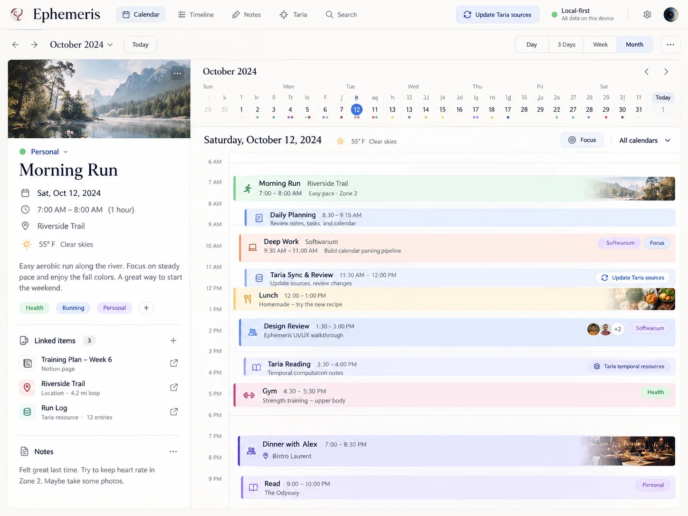

# Designarium

**A public atlas of beautiful application interfaces.**

Designarium is an independent visual reference collection. It archives layouts, information
hierarchies, visual treatments and interaction ideas for software the curator is building,
as well as imagined and unrelated applications. Every project should have its own visual
identity; this is not a template library.

## First collection — Ephemeris

Ephemeris explores dense temporal information in different visual languages. These six
high-resolution concepts were selected for the gallery.

### 01 · The Week in Focus

### The world on a calendar

| Macro & Markets | World Affairs |
| --- | --- |
|  |  |
| **Economics, finance and market events** | **Politics, diplomacy and world affairs** |

| Sports Radar | The Day Command Center |
| --- | --- |
|  |  |
| **Sports schedules, live-score layout and standings** | **Focused day planning, source status and week pulse** |

### A Quieter Day

> **Visual studies, not screenshots of working products.** All depicted events,
> market values, diplomatic meetings, scores, dates, participants, source-health
> indicators and other factual content are illustrative, not verified or live data.

## Website

[The static gallery](index.html) includes image lightboxes, keyboard controls, a
searchable catalog, tags, responsive layout and per-concept metadata.

The site is configured for free publication on GitHub Pages at
`https://sguzman.github.io/designarium/`. **GitHub Pages must be enabled by the
repository owner under Settings → Pages → Build and deployment → Source: GitHub Actions**
before the URL becomes available. The GitHub API integration cannot enable that setting.

After Pages is enabled, a push to `main` automatically deploys the gallery.
The browser smoke-test workflow separately produces desktop/mobile screenshots and checks
the six concept images, filtering, search and fullscreen viewer.

## Extend the atlas

- Website: `index.html`, `style.css`, `app.js`.
- Gallery metadata: `data/concepts.json`.
- Image assets: `assets/concepts/<project>/<slug>.webp`.
- Publication: `.github/workflows/pages.yml`.
- Browser QA: `.github/workflows/qa.yml`, `tests/smoke.mjs`.
- Curatorial rules: [CONTRIBUTING.md](CONTRIBUTING.md) and [AGENTS.md](AGENTS.md).

To preview locally on Linux from the repository root, run
`python3 -m http.server 8000` and open `http://localhost:8000`. The gallery
reads its JSON catalog over HTTP (opening the file directly may be blocked by browsers).

## Architecture

- **Designarium:** Visual concepts and aesthetic references.
- **ViewWright:** Declarative GUI design and rendering semantics.
- **Applications:** Implementation.
- **ViewWitness:** Observational verification.

The website is static, without a database, accounts, analytics, or paid hosting.
